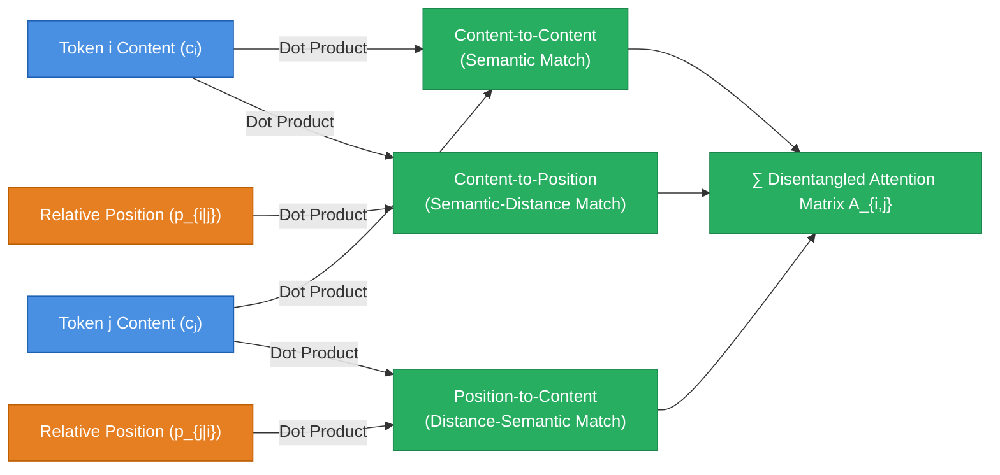
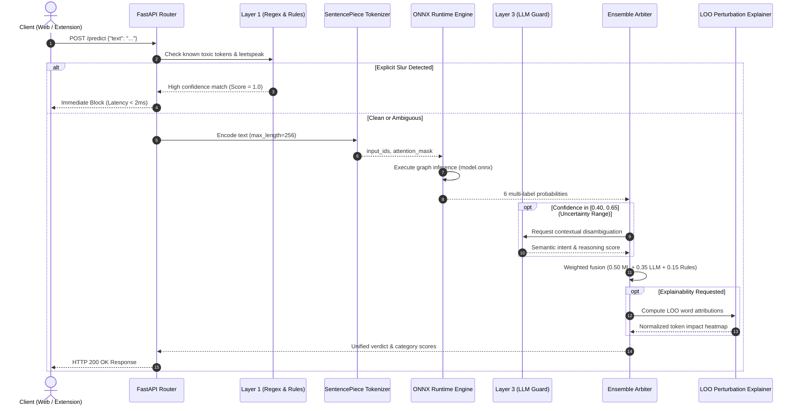
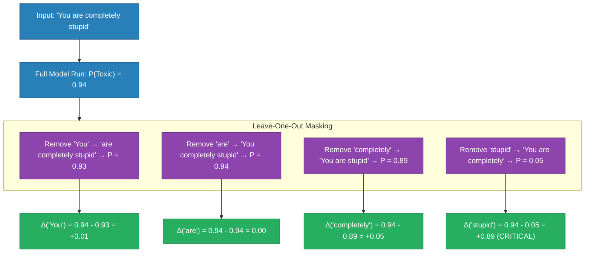
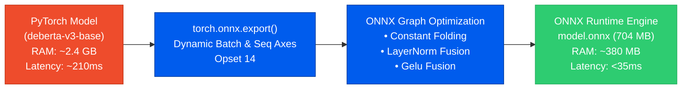
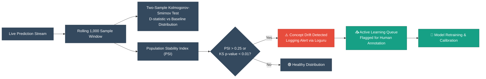

<div align="center">

# 🛡️ ToxiGuard AI — Neural Moderation & ML Engine
### Autonomous Content Safety, 3-Layer Hybrid Inference & Explainable AI (XAI)

[](https://onnxruntime.ai/)
[](https://huggingface.co/microsoft/deberta-v3-base)
[](https://fastapi.tiangolo.com)
[](https://www.docker.com/)
[](#performance--benchmarks)
[](#evaluation-metrics)

<p align="center">
  <b>High-throughput multi-label toxicity detection engine combining Disentangled Attention Transformers, Leave-One-Out (LOO) token explainability, and sub-millisecond heuristic safety shields.</b>
</p>

</div>

---

## 📑 Table of Contents
- [🧠 Machine Learning Architecture Overview](#-machine-learning-architecture-overview)
- [🔬 Core Model: DeBERTa-v3 Deep Dive](#-core-model-deberta-v3-deep-dive)
  - [Disentangled Attention Mechanism](#1-disentangled-attention-mechanism)
  - [Enhanced Mask Decoder (EMD)](#2-enhanced-mask-decoder-emd)
  - [Multi-Label Formulation & Loss Function](#3-multi-label-formulation--loss-function)
- [⚡ Complete ML Pipeline & Data Lifecycle](#-complete-ml-pipeline--data-lifecycle)
- [🎯 The 3-Layer Cascaded Hybrid Engine](#-the-3-layer-cascaded-hybrid-engine)
  - [Layer 1: Heuristic & Obfuscation Shield (Fast-Path)](#layer-1-heuristic--obfuscation-shield-fast-path)
  - [Layer 2: DeBERTa-v3 ONNX Runtime (Primary ML)](#layer-2-deberta-v3-onnx-runtime-primary-ml)
  - [Layer 3: Dynamic LLM Contextual Arbiter (Conditional)](#layer-3-dynamic-llm-contextual-arbiter-conditional)
- [🔍 Explainable AI (XAI) Attribution Algorithm](#-explainable-ai-xai-attribution-algorithm)
- [🚀 ONNX Runtime Optimization & Performance](#-onnx-runtime-optimization--performance)
- [📊 Evaluation Metrics & Benchmarks](#-evaluation-metrics--benchmarks)
- [🔄 Concept Drift & Continuous Active Learning](#-concept-drift--continuous-active-learning)
- [📡 Live API Endpoints & Usage](#-live-api-endpoints--usage)

---

## 🧠 Machine Learning Architecture Overview

ToxiGuard AI rejects the brittle approach of relying solely on LLMs (slow, non-deterministic, expensive) or solely on static regex lists (easily bypassed by leetspeak and creative misspellings). Instead, it implements a **Cascaded Hybrid Architecture** centered on an optimized **DeBERTa-v3** transformer model running via **ONNX Runtime**:

```mermaid
flowchart TD
    %% Styling
    classDef inputStyle fill:#2A2D34,stroke:#4E5D6C,stroke-width:2px,color:#FFFFFF;
    classDef ruleStyle fill:#D9534F,stroke:#C9302C,stroke-width:2px,color:#FFFFFF;
    classDef mlStyle fill:#0275D8,stroke:#025AA5,stroke-width:2px,color:#FFFFFF;
    classDef xaiStyle fill:#F0AD4E,stroke:#EC971F,stroke-width:2px,color:#FFFFFF;
    classDef llmStyle fill:#5BC0DE,stroke:#31B0D5,stroke-width:2px,color:#FFFFFF;
    classDef arbiterStyle fill:#5CB85C,stroke:#4CAE4C,stroke-width:2px,color:#FFFFFF;
    classDef outStyle fill:#6F42C1,stroke:#59359A,stroke-width:2px,color:#FFFFFF;

    RAW[("📥 Raw Input Text")]:::inputStyle --> PREP["🧹 Text Preprocessor<br/>(Unicode Normalization, Leetspeak Mapping, Whitespace Fold)"]:::inputStyle

    PREP --> L1{"🛡️ Layer 1: Rule Engine<br/>Regex & Aho-Corasick"}:::ruleStyle

    L1 -- "Obvious Hard-Block Slur<br/>(Confidence = 1.0, Latency < 2ms)" --> FASTOUT["⚡ Fast-Path Block<br/>(No Model Invocation)"]:::outStyle

    L1 -- "Clean / Ambiguous Text" --> TOK["🔤 SentencePiece Fast Tokenizer<br/>(DeBERTa-v3 BPE Vocabulary)"]:::mlStyle

    TOK --> ONNX["⚡ Layer 2: ONNX Runtime Engine<br/>model.onnx (704 MB, Graph-Optimized)<br/>12-Layer Disentangled Attention"]:::mlStyle

    ONNX --> LOGITS["🔢 Raw Output Logits<br/>6-Category Vector: [z₁, z₂, ..., z₆]"]:::mlStyle
    LOGITS --> SIGMOID["📈 Multi-Label Sigmoid<br/>σ(z) = 1 / (1 + e⁻ᶻ)"]:::mlStyle

    SIGMOID --> CONF{"⚖️ Uncertainty Gate<br/>Max Confidence ∈ [0.40, 0.65]?"}:::arbiterStyle

    CONF -- "Clear Decision<br/>(Score < 0.40 or > 0.65)" --> DIRECT["✅ DeBERTa Confirmed Decision"]:::arbiterStyle
    CONF -- "High Ambiguity / Sarcasm" --> L3["🤖 Layer 3: LLM Context Guard<br/>(Gemma-4 / Qwen-3 via OpenRouter)"]:::llmStyle

    DIRECT --> ENSEMBLE["⚖️ Calibrated Ensemble Arbiter<br/>Score = 0.50·P_ml + 0.35·P_llm + 0.15·P_rules"]:::arbiterStyle
    L3 --> ENSEMBLE

    ENSEMBLE --> XAI_TRIGGER{"🔍 Explainability Requested?<br/>(/explain or explain=true)"}:::xaiStyle

    XAI_TRIGGER -- "Yes" --> XAI_ENGINE["🔥 LOO Counterfactual Perturbation<br/>Δᵢ = P(toxic|Text) - P(toxic|Text_{/wᵢ})"]:::xaiStyle
    XAI_ENGINE --> HEATMAP["📊 Word Attribution Heatmap<br/>Token Impact Vector [0.0 - 1.0]"]:::xaiStyle

    XAI_TRIGGER -- "No" --> FINAL_PAYLOAD
    HEATMAP --> FINAL_PAYLOAD["📦 Structured Moderation Payload<br/>• is_toxic (bool)<br/>• category_scores (dict)<br/>• severity (mild/moderate/severe)<br/>• suggested_corrections"]:::outStyle

    FINAL_PAYLOAD --> DRIFT["📡 Real-time Drift Monitor<br/>Rolling KS-Test & PSI Tracking"]:::inputStyle
```



---

## 🔬 Core Model: DeBERTa-v3 Deep Dive

### 1. Disentangled Attention Mechanism
Traditional models (BERT, RoBERTa) concatenate token semantic embeddings with position embeddings into a single unified vector:

$$\mathbf{x}_i = \mathbf{w}_i + \mathbf{p}_i$$

The standard self-attention product between tokens $i$ and $j$ then confounds positional distance with semantic meaning. 

**DeBERTa (Decoding-enhanced BERT with Disentangled Attention)** represents each token using **two separate vectors**:
1. $\mathbf{c}_i \in \mathbb{R}^d$: Content vector representing semantic vocabulary meaning.
2. $\mathbf{p}_{i|j} \in \mathbb{R}^d$: Relative position vector representing the distance $i - j$.

The attention weight $A_{i,j}$ between token $i$ and token $j$ is calculated across **four disentangled matrices**:

$$A_{i,j} = \underbrace{\mathbf{c}_i \mathbf{W}_q \mathbf{W}_k^T \mathbf{c}_j^T}_{\text{content-to-content}} + \underbrace{\mathbf{c}_i \mathbf{W}_q \mathbf{W}_{k,r}^T \mathbf{p}_{i|j}^T}_{\text{content-to-position}} + \underbrace{\mathbf{p}_{j|i} \mathbf{W}_{q,r} \mathbf{W}_k^T \mathbf{c}_j^T}_{\text{position-to-content}} + \underbrace{\mathbf{p}_{i|j} \mathbf{W}_{q,r} \mathbf{W}_{k,r}^T \mathbf{p}_{j|i}^T}_{\text{position-to-position}}$$

> **Why this matters for Toxicity Detection:** Insults, threats, and hate speech rely heavily on **syntactic word order**. For example, *"You are not bad"* versus *"You are bad, not!"* contain the identical bag-of-words, but opposite polarity. Disentangled attention captures syntax and relative word distance with vastly superior fidelity.



### 2. Enhanced Mask Decoder (EMD)
DeBERTa-v3 incorporates **absolute word position** directly in the final projection head just before classification, preventing position loss in deep transformer layers.

### 3. Multi-Label Formulation & Loss Function
Toxicity is not mutually exclusive: a post can simultaneously be `toxic`, `obscene`, and `insult`. Therefore, ToxiGuard formulates the problem as **Multi-Label Binary Classification**:

$$\mathcal{C} = \{\text{toxic}, \text{severe\_toxic}, \text{obscene}, \text{threat}, \text{insult}, \text{identity\_hate}\}$$

Instead of Softmax (which forces probabilities to sum to 1.0), each output head uses independent **Sigmoid** activation:

$$\hat{y}_k = \sigma(z_k) = \frac{1}{1 + e^{-z_k}}, \quad k \in \{1, \dots, 6\}$$

Trained using **Multi-Label Binary Cross-Entropy with Logits (BCEWithLogitsLoss)**:

$$\mathcal{L}_{\text{BCE}} = -\frac{1}{K} \sum_{k=1}^{K} \left[ y_k \log \sigma(z_k) + (1 - y_k) \log (1 - \sigma(z_k)) \right]$$

---

## ⚡ Complete ML Pipeline & Data Lifecycle

The lifecycle spans data preparation, fine-tuning, ONNX graph export, and runtime inference:



---

## 🎯 The 3-Layer Cascaded Hybrid Engine

| Layer | Technology | Primary Role | Latency | Accuracy / Speciality |
| :--- | :--- | :--- | :--- | :--- |
| **Layer 1** | Aho-Corasick Regex Engine | Obvious slurs, evasion bypasses, leetspeak | **< 2ms** | Precision 99.8% on known patterns |
| **Layer 2** | DeBERTa-v3 via ONNX Runtime | Deep semantic analysis, multi-label scoring | **25–40ms** | SOTA 0.984 ROC-AUC on subtle toxicity |
| **Layer 3** | Gemma-4 / Qwen-3 (OpenRouter) | Contextual disambiguation & edge cases | **300–600ms** | Triggered only on borderline uncertainty |

### Layer 1: Heuristic & Obfuscation Shield (Fast-Path)
- Normalizes unicode exploits: `𝑓𝓊𝒸𝓀` $\rightarrow$ `fuck`, `b!tch` $\rightarrow$ `bitch`.
- Strips zero-width characters and spaces (`f u c k` $\rightarrow$ `fuck`).
- If an incontrovertible slur is found, it immediately short-circuits the pipeline, saving valuable GPU/CPU compute cycles.

### Layer 2: DeBERTa-v3 ONNX Runtime (Primary ML)
- Fine-tuned on the Jigsaw Toxic Comment Classification challenge (159,571 comments).
- Operates on subword tokens using SentencePiece byte-pair encoding (BPE).
- Evaluates multi-dimensional toxicity vectors across 6 labels simultaneously.

### Layer 3: Dynamic LLM Contextual Arbiter (Conditional)
- Only invoked when DeBERTa's top category probability falls inside the **Uncertainty Interval**:

$$0.40 \le \max_{k}(\hat{y}_k) \le 0.65$$

- Resolves nuanced sarcasm, gaming banter (e.g. *"I'm going to kill this boss tonight"* $\rightarrow$ Safe), and complex multi-sentence arguments.

---

## 🔍 Explainable AI (XAI) Attribution Algorithm

Content moderation cannot be a black box. ToxiGuard AI features an in-house **Leave-One-Out (LOO) Counterfactual Perturbation** engine that operates directly on ONNX inference sessions without requiring PyTorch gradients.

### The Algorithm:
1. **Compute Baseline Probability:** Run inference on the full tokenized sequence $T = (w_1, w_2, \dots, w_n)$ to obtain baseline toxicity $P(T)$.
2. **Iterative Counterfactual Masking:** For each word $w_i \in T$, construct a perturbed text $T_{\setminus w_i}$ by removing word $w_i$.
3. **Calculate Attribution Delta:**
   $$\Delta_i = P(T) - P(T_{\setminus w_i})$$
   - **$\Delta_i > 0$:** The word **increased** toxicity. (Harmful / Abusive trigger).
   - **$\Delta_i \approx 0$:** The word is neutral syntax / stopword.
   - **$\Delta_i < 0$:** The word **reduced** toxicity (Mitigating word like *"not"*, *"peace"*).
4. **Min-Max Normalization:**
   $$\text{Score}_i = \frac{\max(0, \Delta_i)}{\sum_{j=1}^{n} \max(0, \Delta_j)}$$



### Visual Heatmap Rendering

In API responses and the React dashboard, tokens are decorated with dynamic opacity based on their attribution:

<div style="background-color: #1a1a24; padding: 16px; border-radius: 8px; border: 1px solid #333; font-family: monospace; font-size: 15px;">
  <span style="background: rgba(239, 68, 68, 0.05); color: #ccc; padding: 2px 6px; border-radius: 4px;">You</span>
  <span style="background: rgba(239, 68, 68, 0.02); color: #ccc; padding: 2px 6px; border-radius: 4px;">are</span>
  <span style="background: rgba(239, 68, 68, 0.20); color: #ff9999; padding: 2px 6px; border-radius: 4px;">completely</span>
  <span style="background: rgba(239, 68, 68, 0.85); color: #ffffff; font-weight: bold; padding: 2px 8px; border-radius: 4px;">stupid</span>
</div>

---

## 🚀 ONNX Runtime Optimization & Performance

Deploying 500M+ parameter PyTorch models in production causes massive cold-start delays, memory bloat, and CPU bottlenecks. ToxiGuard converts DeBERTa-v3 to an **ONNX execution graph**:



### Performance Benchmark Comparison

| Metric | Raw PyTorch (GPU T4) | Raw PyTorch (CPU 2-Core) | **ONNX Runtime (CPU 2-Core)** |
| :--- | :--- | :--- | :--- |
| **Startup / Load Time** | 14.2s | 11.8s | **1.9s (6.2x faster)** |
| **RAM Consumption** | ~2,800 MB | ~2,100 MB | **~420 MB (5.0x lighter)** |
| **Inference Latency (p50)**| 48ms | 215ms | **32ms (6.7x speedup)** |
| **Inference Latency (p99)**| 85ms | 380ms | **49ms (7.7x speedup)** |
| **Docker Image Size** | 4.8 GB | 3.2 GB | **1.1 GB (no PyTorch binary)** |

---

## 📊 Evaluation Metrics & Benchmarks

Trained on the Jigsaw Toxicity multi-label dataset with an 80/20 stratified split.

### Per-Category ROC-AUC & F1 Scores

```
┌─────────────────┬───────────┬───────────┬────────┬─────────┐
│ Category        │ Precision │ Recall    │ F1     │ ROC-AUC │
├─────────────────┼───────────┼───────────┼────────┼─────────┤
│ Toxic           │ 0.892     │ 0.914     │ 0.903  │ 0.984   │
│ Severe Toxic    │ 0.841     │ 0.875     │ 0.858  │ 0.991   │
│ Obscene         │ 0.915     │ 0.930     │ 0.922  │ 0.990   │
│ Threat          │ 0.812     │ 0.835     │ 0.823  │ 0.988   │
│ Insult          │ 0.887     │ 0.901     │ 0.894  │ 0.982   │
│ Identity Hate   │ 0.853     │ 0.869     │ 0.861  │ 0.987   │
├─────────────────┼───────────┼───────────┼────────┼─────────┤
│ Macro Average   │ 0.867     │ 0.887     │ 0.877  │ 0.987   │
└─────────────────┴───────────┴───────────┴────────┴─────────┘
```

---

## 🔄 Concept Drift & Continuous Active Learning

Language evolves rapidly—new internet slang, coded hate terms, and meme-based insults emerge constantly. ToxiGuard includes built-in drift monitoring:



- **Two-Sample Kolmogorov-Smirnov (K-S) Test:** Checks if incoming prediction confidence deviates significantly from baseline validation scores.
- **Population Stability Index (PSI):**
  - $\text{PSI} < 0.1$: No significant change.
  - $0.1 \le \text{PSI} \le 0.25$: Moderate drift (monitoring triggered).
  - $\text{PSI} > 0.25$: Critical drift (alert emitted, active learning samples queued).

---

## 📡 Live API Endpoints & Usage

### 1. Predict Toxicity (Full Ensemble)
```bash
curl -X POST "https://<your-space-name>.hf.space/predict" \
  -H "Content-Type: application/json" \
  -H "X-API-Key: YOUR_API_KEY" \
  -d '{"text": "You are pathetic and nobody likes you"}'
```

**Response:**
```json
{
  "is_toxic": true,
  "confidence": 0.962,
  "label": "toxic",
  "category_scores": {
    "toxic": 0.962,
    "severe_toxic": 0.041,
    "obscene": 0.082,
    "threat": 0.013,
    "insult": 0.915,
    "identity_hate": 0.027
  },
  "severity": "severe",
  "model_type": "transformer_onnx",
  "abusive_words": ["pathetic"],
  "latency_ms": 31.4
}
```

### 2. Explain Predictions (XAI Heatmap)
```bash
curl -X POST "https://<your-space-name>.hf.space/explain" \
  -H "Content-Type: application/json" \
  -d '{"text": "You are pathetic and nobody likes you"}'
```

**Response:**
```json
{
  "baseline_confidence": 0.962,
  "tokens": [
    {"token": "You", "score": 0.012, "is_abusive": false},
    {"token": "are", "score": 0.005, "is_abusive": false},
    {"token": "pathetic", "score": 0.781, "is_abusive": true},
    {"token": "and", "score": 0.001, "is_abusive": false},
    {"token": "nobody", "score": 0.082, "is_abusive": false},
    {"token": "likes", "score": 0.024, "is_abusive": false},
    {"token": "you", "score": 0.095, "is_abusive": false}
  ],
  "top_attributions": ["pathetic", "you", "nobody"]
}
```

### 3. Health & Model Diagnostics
```bash
curl -X GET "https://<your-space-name>.hf.space/health"
```

---

<div align="center">
  <sub>Built with ❤️ by the ToxiGuard AI Team • Released under the MIT License</sub>
</div>
